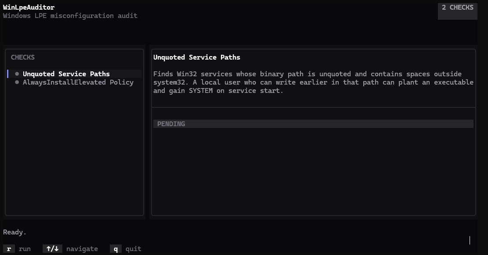

# WinLpeAuditor

A small Windows local-privilege-escalation (LPE) misconfiguration auditor with a terminal UI, built with C++20 and [FTXUI](https://github.com/ArthurSonzogni/FTXUI).



Checks included:
- **Unquoted Service Paths** - Win32 services with an unquoted binary path containing spaces, exploitable if a user can write earlier in that path.
- **AlwaysInstallElevated Policy** - flags when both `HKCU` and `HKLM` allow any user to install `.msi` packages with SYSTEM rights.
- **Token Privilege:** Flags highly dangerous Windows privileges (e.g., `SeImpersonatePrivilege`, `SeDebugPrivilege`) assigned to the current process token that open direct paths to local privilege escalation.
- **Modifiable Service Binaries:** Scans all registered Windows services and parses file ACLs to ensure low-privileged user groups (like `Everyone` or `Authenticated Users`) do not possess write permissions over the service executables.
- **Point and Print Policy:** Audits `HKLM` printer policies to ensure that the installation of remote printer drivers is restricted to administrators and that elevation warnings have not been dangerously disabled.
- **Logon Autostart (Registry Run Keys):** Checks global HKLM Run and RunOnce keys for write permissions granted to standard user groups.
- **Logon Autostart (Startup Folder):** Audits the file permissions of the system-wide startup directory to prevent unprivileged shortcut planting.
- **WSL Root Default User Configuration:** Inspects user-specific registry entries for Windows Subsystem for Linux (WSL) to detect distributions that automatically log in as the `root` user (UID 0).

## Requirements

- Windows (uses the Win32 Registry and Service Control Manager APIs)
- CMake 3.21+
- A C++20 compiler (MSVC via Visual Studio / Build Tools)

## Build

```powershell
cmake -B build -S .
cmake --build build
```

FTXUI is fetched automatically via CMake's `FetchContent` on first configure.

## Run

```powershell
.\build\WinLpeAuditor.exe
```

Keybinds: `r` run audit · `↑`/`↓` navigate checks · `q` quit.

## Adding a new check

Implement the `ICheck` interface (`include/Core/ICheck.h`), add the `.cpp` to `CMakeLists.txt`, and register it in `src/main.cpp`:

```cpp
engine.Register(std::make_unique<Checks::YourNewCheck>());
```

No other code needs to change.

## Disclaimer

For use only in environments and systems you are authorized to assess.

## TODO
- [ ] Implement more privesc Checks
- [ ] Releases pipeline
